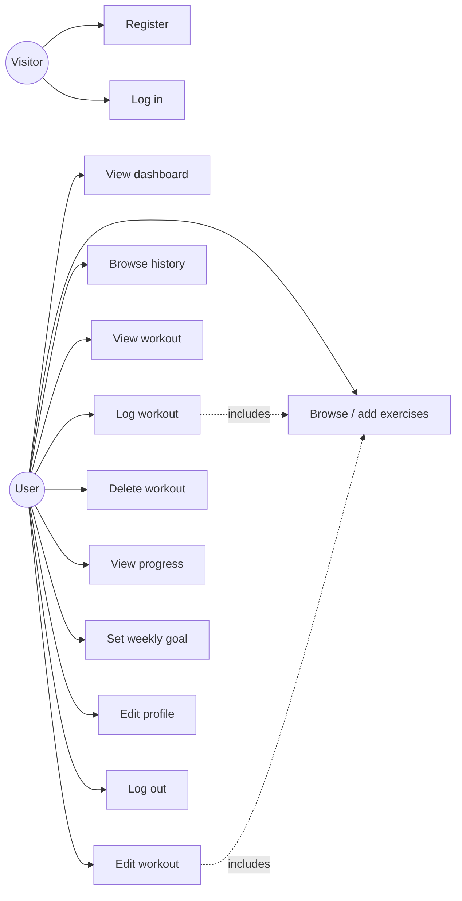
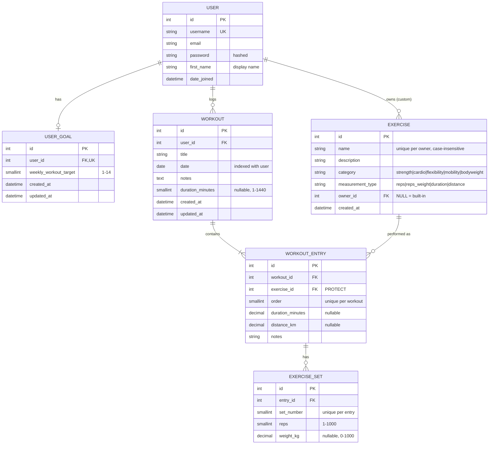

# Engineering Notes: Fitness Workout Logger

This is lightweight software-engineering documentation for the MVP. It describes the system *as implemented*.

## 1. Functional requirements

| ID | Requirement | Status |
|---|---|---|
| FR-1 | A visitor can register with username, email, password and password confirmation | Implemented, tested |
| FR-2 | A user can log in with username **or** email and log out | Implemented, tested |
| FR-3 | A user can browse and search the exercise library by name and category | Implemented, tested |
| FR-4 | A user can add private custom exercises | Implemented, tested |
| FR-5 | A user can log a workout with ≥ 1 exercise; inputs depend on the measurement type | Implemented, tested |
| FR-6 | A user can record individual sets (reps and optional weight) | Implemented, tested |
| FR-7 | A user can view workout history (newest first, paginated, filterable) | Implemented, tested |
| FR-8 | A user can view, edit and delete their own workouts | Implemented, tested |
| FR-9 | The dashboard shows real statistics, a 7-day chart and recent workouts | Implemented, tested |
| FR-10 | The progress page shows weekly activity and consistency trends | Implemented, tested |
| FR-11 | A user can set a weekly workout goal and see progress and a streak | Implemented, tested |
| FR-12 | A user can update their display name, username and email | Implemented, tested |

## 2. Non-functional requirements

| Area | Requirement | How it is met |
|---|---|---|
| Security | Passwords hashed; sessions protected; CSRF enforced | Django PBKDF2 hashing, `HttpOnly` session cookie, CSRF checked even on anonymous login/register |
| Privacy | Users can only access their own data | All querysets are filtered by `request.user`; another user's workout returns 404 |
| Integrity | A workout is never partially saved | `transaction.atomic` around nested create/update; DB constraints |
| Usability | Clear feedback for every action | Loading skeletons, toasts, inline field errors, empty states with next actions |
| Accessibility | WCAG 2.1 AA intent | Semantic landmarks, labelled fields, `aria-invalid`/`aria-describedby`, focus-trapped dialogs, visible focus, reduced motion, chart data tables for screen readers, AA contrast for text |
| Responsiveness | Usable from 360 px to 1440 px | Mobile bottom nav with a central "Log" action, desktop sidebar; checked at 360, 390 and 1440 px with no horizontal scroll |
| Performance | No N+1 queries; small payloads | `prefetch_related`/`select_related`, annotated counts (the history list uses 3 queries regardless of size, enforced by a test); vendor chunk splitting |
| Maintainability | Small, focused modules | Design tokens in one CSS file; pure, unit-tested form logic; separate settings per environment |

## 3. User stories

1. *As a beginner*, I want to sign up quickly so that I can start logging today.
2. *As a user*, I want to log a workout with several exercises and sets so that I have an accurate record.
3. *As a runner*, I want to log distance and time instead of sets so that the form fits my activity.
4. *As a user*, I want to see my past workouts and open any of them so that I remember what I did.
5. *As a user*, I want to fix mistakes in a workout or delete it so that my journal stays accurate.
6. *As a user*, I want a weekly goal and to see how close I am so that I stay motivated.
7. *As a user*, I want charts of my weekly activity so that I can see my consistency at a glance.
8. *As a user*, I want my data to be private so that nobody else can see or change it.
9. *As a home-workout user*, I want to add my own exercises so that the library fits my routine.

## 4. Use-case diagram

## 5. Data model

**Integrity rules:**

- **Cascades.** Deleting a user deletes their goal, workouts and custom exercises. Deleting a workout deletes its entries and sets.
- **Protected exercises.** `WorkoutEntry.exercise` uses `PROTECT`, so a logged exercise cannot vanish from history. The API answers `409` instead.
- **Database constraints.**
  - Unique `(workout, order)` and `(entry, set_number)`.
  - Reps ≥ 1 and weight ≥ 0 (check constraints).
  - Goal target between 1 and 14.
  - Case-insensitive unique exercise names, both among built-ins and per owner.
- **Measurement rules are enforced in the serializer**, because they depend on the referenced exercise:

| `measurement_type` | Requires | Forbids |
|---|---|---|
| `reps` | ≥ 1 set with reps | weight, duration, distance |
| `reps_weight` | ≥ 1 set with reps (weight optional) | duration, distance |
| `duration` | `duration_minutes` | sets, distance |
| `distance` | `distance_km` (duration optional) | sets |

**Units:** kilograms, minutes and kilometres. Decimals use 2 decimal places.

## 6. Key engineering decisions

### Authentication: same-origin sessions, not JWT
The SPA and the API share one origin: through the Vite proxy in development, and because Django serves `frontend/dist` in production. That makes Django's session cookie the simplest secure option:

- The session cookie is `HttpOnly` (unreadable by JavaScript) and `SameSite=Lax`, and `Secure` in production.
- The CSRF token is read from the `csrftoken` cookie and sent as `X-CSRFToken`. DRF normally skips CSRF for anonymous requests, so `login` and `register` call `enforce_csrf` explicitly to prevent login-CSRF. A test covers this.
- No long-lived tokens ever touch `localStorage`, and no CORS configuration is needed.
- A small `SessionAuthentication401` subclass makes unauthenticated requests return **401** rather than DRF's default 403. The SPA can then tell "signed out" apart from "forbidden".

### Nested workout writes
`POST/PATCH /api/workouts/` accept the whole workout tree. The serializer validates every entry against its exercise's measurement type, then writes inside `transaction.atomic`.

On update, a submitted `entries` list replaces the existing entries. This is simpler and less error-prone than diffing nested lists, and set numbering and ordering always stay consistent. Two tests check this: one injects a failure part-way through to prove create rolls back, the other proves an update failure keeps the original entries.

### Ownership
Every queryset starts from `request.user`, so another user's workout is simply "not found" (404). That avoids leaking which IDs exist. Custom exercises use an object permission: built-ins are read-only, and only the owner can edit theirs. Workouts can only reference built-in exercises or the user's own custom ones.

### Analytics definitions
- **Workout:** one saved `Workout` row. It counts once, however many exercises it has.
- **Logged exercise:** one `WorkoutEntry`.
- **Week:** Monday to Sunday (ISO 8601).
- **Dates and time zones:** a workout's date is the calendar date the user picked, so it is never converted. "Today" comes from the browser (`?today=YYYY-MM-DD`). The server accepts it only within ±1 day of its own date and otherwise falls back to its own date. This keeps "this week" correct for users in other time zones.
- **Time trained:** the sum of the optional session durations. The UI says how many workouts recorded a duration.
- **Goal streak:** the number of consecutive weeks with at least the current weekly target. The current week counts once its target is met; until then, counting starts from last week.

### Frontend structure
- **Design tokens** (palette, radii, shadows) live in `@theme` in `index.css`, and components use only the token utilities.
- **Workout-form logic is plain TypeScript.** Draft state, validation, payload mapping and server-error mapping are in `utils/workoutForm.ts`, which is unit-tested without React.
- **Loading.** `useApi` aborts stale requests, so a slow response never overwrites a newer one.
- **Double-submit protection.** A ref guard blocks a second submit even before React re-renders, and the submit button is disabled while saving.
- **Failed saves keep the user's input.** The form stays filled in and shows an explanation.

### Scope discipline
There is no Redux, no React Query, no Docker, no Celery, and no CORS package. The only runtime frontend dependencies are React, React Router, Recharts and Lucide.

## 7. Testing strategy

| Level | Tool | Where | Count |
|---|---|---|---|
| Backend unit/integration | Django `TestCase`/`APITestCase` | `backend/*/tests/` | 67 |
| Frontend unit | Vitest | `src/utils/*.test.ts`, `src/api/*.test.ts` | 15 |
| Frontend component | Vitest + React Testing Library + user-event | `src/__tests__/` | 25 |
| Manual end-to-end | Browser against the running dev servers | — | 5 flows |

**Backend coverage, mapped to the required test list:**

1. Registration: success, hashing, auto sign-in, duplicates, weak and mismatched passwords
2. Login: by username and by email (case-insensitive), CSRF required, `HttpOnly` cookie
3. Invalid and inactive-user login
4. Unauthenticated access: 401 on every private endpoint
5. Creating a workout
6. A workout with several exercises
7. Per-set storage, including weights
8. History ordering, pagination and filters, plus an N+1 guard
9. Update replaces entries without leaving orphans
10. Delete cascades
11. Cross-user isolation: read, update, delete and spoofing the `user` field
12. Invalid input: title, dates, reps, weights, durations, distances, unknown and foreign exercises, limits
13. Transaction rollback on create and on update
14. Dashboard statistics: totals, week, durations, last 7 days, no leakage between users
15. Progress: Mon–Sun weekly breakdown, trends, categories, top exercises, streak rules

**Frontend coverage:**
- Auth forms: rendering, required errors, password toggle, API and server field errors, success navigation
- Workout builder: exercise search, type-specific inputs, add/copy/remove sets, remove exercise, validation, payload shape, double-submit guard, data kept on API failure, server errors mapped to fields
- History: rendering, empty state, delete confirmation (focus on Cancel, Escape, cancel and confirm)
- Dashboard: real numbers, goal progress bar, empty state, error-and-retry
- API client: CSRF header, query building, error normalisation, network failure

**Manual end-to-end verification** used the in-app browser against `runserver` + `vite`:

| Flow | Result |
|---|---|
| 1. Register → (auto) login → empty dashboard | ✅ |
| 2. Log in → create workout (validation caught a negative weight) → save → detail → history | ✅ |
| 3. View → edit (rename and add a Running entry) → save → changes visible | ✅ |
| 4. History → delete → confirm → list and count update | ✅ |
| 5. Demo data → dashboard and progress figures match the records (week count, 6-week streak) | ✅ |
| Ownership: opening another user's workout URL shows "not found" | ✅ |
| Layout at 360 / 390 / 1440 px: no horizontal scroll | ✅ |
| Production settings: Django + WhiteNoise serve the SPA, assets and API from one origin | ✅ (`check --deploy` warns only on the HSTS subdomain/preload options, which are domain decisions) |
